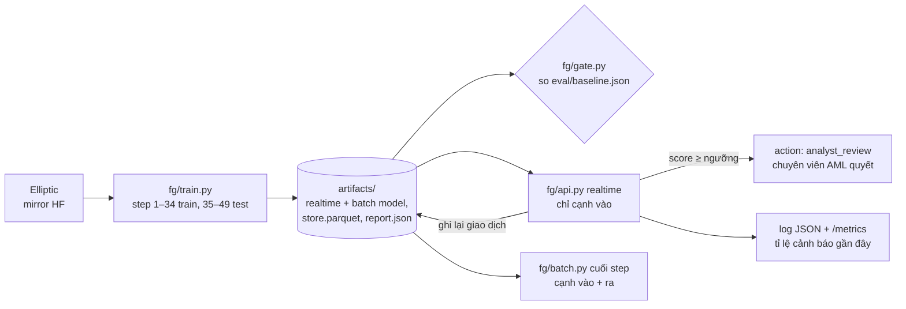

# Fraud Graph: phát hiện giao dịch bất hợp pháp trên đồ thị thanh toán

Dự án phát hiện giao dịch bất hợp pháp trên đồ thị thanh toán Bitcoin, gồm các phần:

- anomaly detection không giám sát
- supervised learning (LightGBM)
- đặc trưng đồ thị và collective classification hai tầng
- semi-supervised (self-training)
- một mô hình chấm điểm **realtime**, một mô hình **batch** cuối kỳ
- monitoring drift
- Docker và CI

**Dữ liệu:** Elliptic, gồm 203.769 giao dịch, 234.355 cạnh thanh toán và 49 time step. Trong đó 4.545 giao dịch là illicit, 42.019 là licit, còn 77 % chưa có nhãn. Đặc trưng đã được ẩn danh: 93 đặc trưng local và 72 đặc trưng tổng hợp. Lệnh `python -m fg.train` tự tải dữ liệu từ mirror trên Hugging Face.

## Thiết lập

- Chia theo thời gian như paper gốc: train trên step 1–34, test trên step 35–49 (16.670 giao dịch có nhãn, 6,5 % illicit).
- Các cạnh chỉ nối giao dịch **trong cùng một step**.
- Điểm out-of-fold trên tập train được tính bằng fold theo khối thời gian.
- Test `test_test_labels_never_used` lật toàn bộ nhãn tập test và kiểm tra điểm dự đoán không đổi.

**Realtime và batch khác nhau ở thông tin đồ thị:**

- Khi một giao dịch đến, ta mới biết các **input** của nó, tức các giao dịch nó tiêu từ đó (cạnh vào).
- Các giao dịch sẽ tiêu từ nó (cạnh ra) chỉ xuất hiện sau.
- Mô hình realtime vì thế chỉ dùng đặc trưng cạnh vào. Mô hình batch chạy cuối step và dùng cả hai chiều.
- Nếu train bằng cạnh ra mà serve realtime thì sẽ bị train/serve skew.

```
giao dịch mới + input ids ──► online store (đặc trưng local + điểm tầng 1 của mọi giao dịch đã biết)
                                │  mean đặc trưng của hàng xóm, bậc vào
                                ▼
                     LightGBM tầng 1 (AF + NE_in) ──► s1 ──► ghi lại vào store
                                │  mean/max s1 của hàng xóm (collective)
                                ▼
                     LightGBM tầng 2 (AF + NE_in + S_in) ──► điểm, cảnh báo
```

## Kiến trúc



**Quyết định thiết kế**

- **Tách realtime và batch theo thông tin có được lúc chấm:** realtime chỉ dùng cạnh vào để không có train/serve skew; batch cuối step dùng cả hai chiều. Test parity bắt buộc điểm API trùng điểm offline.
- **Hai tầng LightGBM thay vì GNN:** tầng 2 dùng điểm tầng 1 của hàng xóm (collective). Đơn giản, giải thích được, và trên Elliptic GNN của paper không thắng Random Forest.
- **Ngưỡng chọn trên out-of-fold (0,24), không trên test:** chọn trên test là rò rỉ; `FG_THRESHOLD` để khớp ngân sách cảnh báo.
- **API không tự chặn giao dịch:** điểm vượt ngưỡng trả `action: analyst_review`, quyết định cuối thuộc về người. Lý do: sau step 43 mô hình sập, nên tự động chặn dựa trên nó là rủi ro.
- **Theo dõi tỉ lệ cảnh báo, không chỉ PSI điểm:** PSI không bắt được sự cố step 43; tỉ lệ cảnh báo rơi mạnh là tín hiệu thô nhưng có thật.

## Kết quả trên tập test (`artifacts/report.json`)

Precision, recall và F1 tính ở ngưỡng 0,5; PR-AUC không phụ thuộc ngưỡng.

| Mô hình | Đặc trưng | PR-AUC | Precision | Recall | F1 |
|---|---|---|---|---|---|
| Isolation Forest (không nhãn) | AF | 0,036 | precision@k = 0 | | |
| Random Forest (baseline của paper) | AF | 0,785 | 0,927 | 0,724 | 0,813 |
| LightGBM | chỉ local | 0,790 | 0,865 | 0,702 | 0,775 |
| LightGBM | AF | 0,805 | 0,947 | 0,726 | 0,822 |
| LightGBM realtime tầng 1 | AF + NE_in | 0,808 | 0,949 | 0,724 | 0,821 |
| **LightGBM realtime tầng 2** | AF + NE_in + S_in | 0,810 | 0,940 | 0,725 | 0,819 |
| LightGBM batch tầng 1 | AF + NE in/out | 0,814 | 0,944 | 0,722 | 0,818 |
| **LightGBM batch tầng 2** | AF + NE + S in/out | **0,814** | 0,940 | 0,734 | **0,824** |

Random Forest đạt F1 0,813, khớp với mức khoảng 0,79–0,80 mà paper Elliptic (Weber et al., 2019) báo cáo. Các phát hiện chính:

1. **Anomaly detection không giám sát thất bại.** PR-AUC 0,036 còn thấp hơn tỉ lệ nền 0,065. Giao dịch bất hợp pháp ở đây không "lạ" về mặt thống kê; chúng giống một kiểu hành vi khác chứ không phải điểm ngoại lai. Bài học là đừng mặc định dùng Isolation Forest khi đã có nhãn, dù chỉ ít nhãn.
2. **Đặc trưng đồ thị chỉ giúp ít.** PR-AUC tăng từ 0,805 lên 0,814, một phần vì 72 đặc trưng tổng hợp của Elliptic vốn đã gom thông tin từ hàng xóm. Chênh lệch giữa realtime (chỉ cạnh vào) và batch (đủ hai chiều) là 0,004 PR-AUC. Như vậy ràng buộc realtime gần như không làm mất chất lượng.
3. **Ngưỡng chọn trên out-of-fold làm F1 tệ đi.** Ngưỡng tối ưu F1 trên out-of-fold của tập train là 0,24 (realtime) và 0,30 (batch); trên test, F1 giảm còn 0,787 và 0,807. Nguyên nhân là phân phối điểm thay đổi theo thời gian. API vẫn giữ ngưỡng out-of-fold, vì chọn 0,5 sau khi đã nhìn kết quả test là gian lận. Có thể ghi đè bằng `FG_THRESHOLD`, ví dụ để khớp ngân sách cảnh báo của đội điều tra.

### Drift: sau step 43 mô hình gần như không bắt được gì

| | Step 35–42 | Step 43–49 |
|---|---|---|
| F1 realtime tầng 2 | 0,909 | **0,030** |
| Tỉ lệ illicit có nhãn | 9,2 % | 2,5 % |
| Trung vị điểm của giao dịch illicit | | 0,0006 (chỉ 1,8 % vượt 0,5) |

Ở step 43 một chợ đen đóng cửa. Kiểu gian lận mới xuất hiện sau đó trông giống giao dịch hợp lệ trong không gian đặc trưng, và mọi mô hình đều sụp đổ. Paper gốc cũng ghi nhận hiện tượng này.

**Monitoring không có nhãn không phát hiện được:** PSI của phân phối điểm ở step 43–49 dao động 0,07–0,30, cùng biên độ với step 35–42 (0,07–0,24). Tỉ lệ cảnh báo cũng không đổi bất thường. Bài học vận hành:

- Cần vòng phản hồi nhãn từ đội điều tra để đo precision/recall theo thời gian.
- Cần lấy mẫu ngẫu nhiên một phần giao dịch *không* bị cảnh báo để gắn nhãn, nếu không sẽ không thấy được recall.
- Cần retrain định kỳ; không thể chỉ trông vào PSI.

Endpoint `/monitoring` trả bảng theo từng step: số giao dịch, tỉ lệ cảnh báo, PSI, precision/recall.

### Semi-supervised: self-training không giúp

Giữ lại 2 % hoặc 10 % nhãn train, rồi gán nhãn giả cho các node tự tin nhất trong khoảng 186 nghìn node không nhãn (157 nghìn node unknown cộng các node train bị ẩn nhãn). Lặp 3 vòng, giữ nguyên tỉ lệ lớp, lấy trung bình 3 seed.

| Nhãn giữ lại | Số nhãn | Supervised PR-AUC / F1 | Self-training PR-AUC / F1 |
|---|---|---|---|
| 2 % | khoảng 600 | 0,751 / 0,750 | 0,744 / 0,739 |
| 10 % | khoảng 3.000 | 0,788 / 0,791 | 0,792 / 0,783 |

Chỉ khoảng 600 nhãn đã đạt 93 % PR-AUC so với dùng đủ 30 nghìn nhãn. Nhãn giả từ chính mô hình chỉ củng cố những gì mô hình đã biết nên không thêm thông tin. Label propagation trên đồ thị không dùng được ở đây, vì cạnh không nối giữa các step: nhãn ở step train không lan được sang step test.

## Chạy

```bash
uv venv -p 3.11 .venv && uv pip install -p .venv -r requirements.txt
.venv/Scripts/python -m fg.train        # tải 700 MB, khoảng 55 phút trên máy đang chia CPU (1 luồng/mô hình)
.venv/Scripts/python -m pytest -q       # 8 test trên đồ thị tổng hợp, khoảng 2,5 phút
.venv/Scripts/python -m fg.gate        # regression gate trên artifacts/report.json
.venv/Scripts/uvicorn fg.api:app --port 8000
.venv/Scripts/python -m fg.batch 43 44  # batch cuối step dùng cạnh vào + ra → artifacts/batch_scores.parquet
docker build -t fraud-graph . && docker run -p 8000:8000 -e FG_API_KEY=<key> fraud-graph
```

```bash
curl -X POST localhost:8000/score -H 'content-type: application/json' -H 'X-API-Key: <key>' \
  -d '{"tx_id": 1, "features": [0.0, ... 165 số ...], "inputs": [230425980]}'
# {"tx_id":1,"score":0.003,"alert":false,"threshold":0.24,"action":"pass","inputs_found":1,"model_version":"3be09b62721e","latency_ms":23.5}
```

Trên dữ liệu thật, đo 200 giao dịch qua API: điểm realtime khớp offline (sai lệch tối đa 1,3e-4); latency p50 23 ms, p95 57 ms khi CPU đang bận.

## MLOps

- **CI** (`.github/workflows/ci.yml`): sinh một đồ thị tổng hợp có tính đồng loại (homophily), train toàn bộ pipeline rồi kiểm tra:
  - không dùng nhãn test
  - **train/serve parity**: điểm realtime qua API và điểm của batch job phải trùng với điểm offline
  - store ghi lại giao dịch mới
  - validate input
  - quality gate PR-AUC
- **Regression gate** (`python -m fg.gate`, chạy trong CI): `artifacts/report.json` không được thấp hơn `eval/baseline.json` quá 0,02 (PR-AUC realtime/batch, F1 batch, F1 và recall realtime ở ngưỡng OOF), và phải thắng Random Forest, LightGBM không có đặc trưng đồ thị, Isolation Forest trên cùng tập test.
- **API:**
  - `FG_API_KEY` đặt thì mọi endpoint trừ `/health` cần header `X-API-Key`.
  - Validate input: đúng 165 đặc trưng hữu hạn, `tx_id >= 0`, tối đa 1.000 input; sai thì 422. Thiếu artifact trả 503, không 500.
  - Log JSON mỗi request: `request_id` (nhận từ `X-Request-ID` hoặc tự sinh), route, status, latency, `model_version` (SHA-256 rút gọn của `realtime.joblib`); `/score` ghi thêm `tx_id`, điểm, cảnh báo để dựng lại quyết định.
  - `GET /metrics`: số request theo route/status, latency p50/p95, **tỉ lệ cảnh báo trên 1.000 giao dịch gần nhất**.
- **Online store:** lưu đặc trưng local và điểm tầng 1 của mọi giao dịch đã biết. Giao dịch vừa chấm được ghi lại để giao dịch sau dùng làm hàng xóm.

## Giới hạn và bước tiếp

- Metrics và online store đang nằm trong bộ nhớ, một tiến trình. Lên production cần Redis hoặc feature store, đồng thời xử lý việc input đến trễ.
- Chưa thử GNN (GraphSAGE/GAT). Paper cho thấy GCN thua Random Forest trên Elliptic, và kết quả ở mục 2 cho thấy đặc trưng hàng xóm chỉ thêm ít. Nên ưu tiên giải quyết drift trước.
- Hướng xử lý drift: retrain theo cửa sổ trượt khi có nhãn mới, lấy mẫu kiểm tra ngẫu nhiên, và thêm luật cứng do chuyên gia viết cho kiểu gian lận mới.
